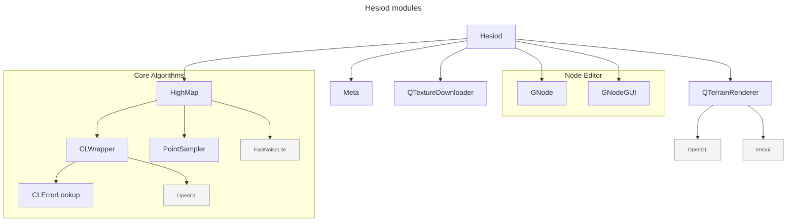

# Hesiod - https://hesiodengine.com

A desktop application for node-based procedural terrain generation.
- binaries: https://hesiodengine.com/#download
- Discord: https://discord.gg/HBgFCjdV8W
- tutorial videos (WIP): https://www.youtube.com/@Hesiod-s9n
- documentation (WIP): https://hesiodengine.com/docs/
- roadmap: https://github.com/ottolink-dev/Hesiod/discussions/608

>[!WARNING] 
> Work in progress, use at your own risk!


## License

This project is licensed under the GNU General Public License v3.0.

## Getting started

### Standalone executables for Windows and Linux

Download from https://hesiodengine.com/#download and choose **Stable** or
**Dev build**. Extract the entire ZIP and keep the bundled runtime files and
`data` folder together. On Windows, run `hesiod.exe`; on Linux, run
`chmod +x hesiod.AppImage` followed by `./hesiod.AppImage` from the extracted folder.

See the [installation guide](docs/getting_started/installation.md) for platform
requirements, troubleshooting and the status of experimental macOS packages.

### Nix / NixOS

The repository is a Nix flake. To try Hesiod without installing anything:

``` bash
nix run 'git+https://github.com/ottolink-dev/Hesiod?ref=main'   # main branch
nix run 'git+https://github.com/ottolink-dev/Hesiod?ref=dev'    # development branch
```

Use the `git+https://` form: the `github:` shorthand fetches a tarball that
does not include the submodules, and the flake refuses to build such a tree.

To install it on NixOS, add the flake as an input and put
`hesiod.packages.${system}.default` in `environment.systemPackages`
(an overlay is exported as `overlays.default` too). GPU acceleration needs
an OpenCL ICD on the host, for instance `hardware.graphics.extraPackages`
with your vendor's OpenCL package on NixOS.

The launcher runs Hesiod from `~/.local/share/hesiod` (honouring
`XDG_DATA_HOME`), where the packaged `data/` directory is symlinked and
run-time files such as the texture cache are written.

### Windows

#### Getting the sources

Use `PowerShell` to clone the repository (because Visual Studio won't clone the submodules) using `git` command lines:
``` bash
git clone --recurse-submodules https://github.com/ottolink-dev/Hesiod.git
```

Submodules are fetched over https; no GitHub account is required to build.

Install [Qt6](https://doc.qt.io/qt-6/windows.html) and install the missing OpenSource dependencies using `vcpkg`:
```
vcpkg install glfw3 opengl gsl glew freeglut glm libpng glm opencl assimp spdlog opencv[openexr]
```

You should then be able to build the sources using Visual Studio.

### macOS / Apple Silicon (experimental)

The native macOS path uses the existing OpenGL viewer and Apple's OpenCL
framework. A Metal backend is not required for this development build.

Install Apple's Command Line Tools (`xcode-select --install`) and native ARM
[Homebrew](https://brew.sh), then install the dependencies:

```bash
brew install cmake ninja qt spdlog nlohmann-json glm assimp opencv fftw gsl \
  libomp openexr libtiff zstd glfw opencl-headers opencl-clhpp-headers
git submodule update --init --recursive
bash scripts/build-macos.sh
```

The script configures an ARM64 Release build in `build/macos` and builds with
two jobs. Set `HESIOD_BUILD_JOBS` to change the parallelism. Additional script
arguments are passed to CMake. The first configure also downloads HighMap's
FetchContent dependencies and needs network access.

Launch the development app:

```bash
open build/macos/bin/Hesiod.app
```

The build script applies the tracked patches in `scripts/macos/patches` to the
pinned HighMap and Meta submodules. They add a missing OpenCL hash helper,
handle Apple's OpenMP compiler flags, limit OpenCV to the used components,
and include a required standard header.
This leaves those submodules with local source modifications; keep the patches
until the fixes are available in newer pinned dependency commits.

The development bundle uses Homebrew libraries. To create a standalone app and
ZIP (Python 3.11 or newer is required):

```bash
python3 scripts/macos/package_app.py --output output/macos-package
python3 scripts/macos/verify_bundle.py output/macos-package/Hesiod.app
```

Use a fresh output directory for each packaging run. The package contains Qt,
the WebEngine helper/resources, required plugins, other runtime libraries,
the application data, licenses, source revision information and dependency
patches. The script creates `hesiod-macos-arm64.zip`, its SHA-256 checksum,
and `verification.json`. The minimum macOS version is derived from all bundled
binaries and recorded in both `Info.plist` and the verification report. Builds
made on newer macOS/Homebrew installations may require a newer OS than CI builds.

The app can be moved into Applications and launched from Finder. Runtime files
and caches go under `~/Library/Application Support/hesiod/runtime/`; preferences
and autosaves use their existing per-user locations. Bundled assets are read
through a symlink from this workspace, keeping the app bundle unchanged.
Command-line project paths are resolved from the caller's original directory.

These packages have an **ad-hoc signature**, required by Apple Silicon, but
no Developer ID signature or Apple notarization. No Apple Developer account is
needed to build them. Downloaded copies may be blocked by Gatekeeper; users
must explicitly approve a trusted build through macOS Privacy & Security.
The SHA-256 file detects download corruption; it does not establish publisher
identity.

`.github/workflows/macos-build.yml` runs the same build on an Apple Silicon
runner for pushes and pull requests to `main`/`dev`, and can be run manually.
It builds and audits the standalone package and uploads the ZIP, checksum,
source information and verification report as a 14-day Actions artifact.
The audit checks every bundled Mach-O, including plugins and the WebEngine
helper, for ARM64 support, dependency closure and valid signatures. Hosted CI
does not test GPU rendering. It does not publish packages to the website.

### Linux

There are also required external dependencies for ubuntu you can execute:
```
sudo apt-get -y install libglfw3 libglfw3-dev libglew-dev libopengl-dev freeglut3-dev libboost-all-dev libeigen3-dev libglm-dev fuse libfuse2 ocl-icd-opencl-dev libassimp-dev qt6-webengine-dev zlib1g-dev
```

> [!NOTE]
> AMD users on Linux may need to install `rocm-opencl` and `rocm-clinfo` for OpenCL compatibility.

#### Getting the sources

Use `git` to retrieve the sources: 
``` bash
git clone https://github.com/ottolink-dev/Hesiod.git
cd Hesiod
git submodule update --init --recursive
```

Submodules are fetched over https; no GitHub account is required to build.

#### Building

Build by making a build directory (i.e. `build/`), run `cmake` in that dir, and then use `make` to build the desired target.

Example:
``` bash
mkdir build && cd build
cmake ..
make hesiod
```

Start the main executable:
```
bin/./hesiod
```

## Dependencies and module structures


