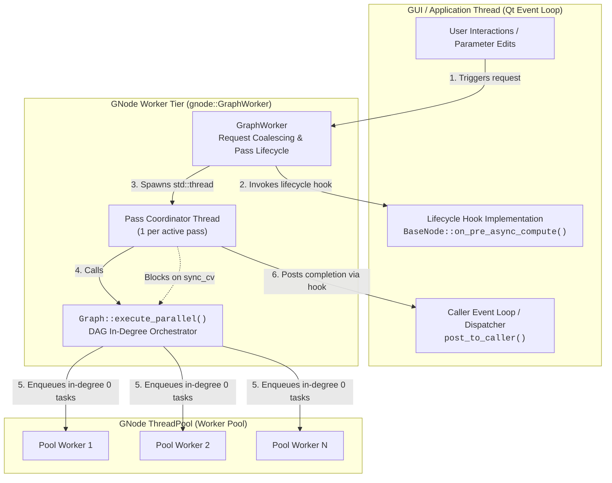
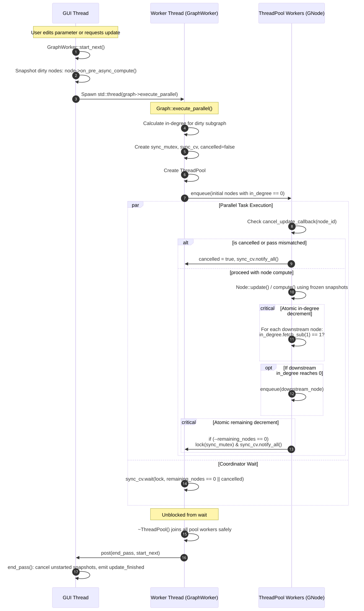
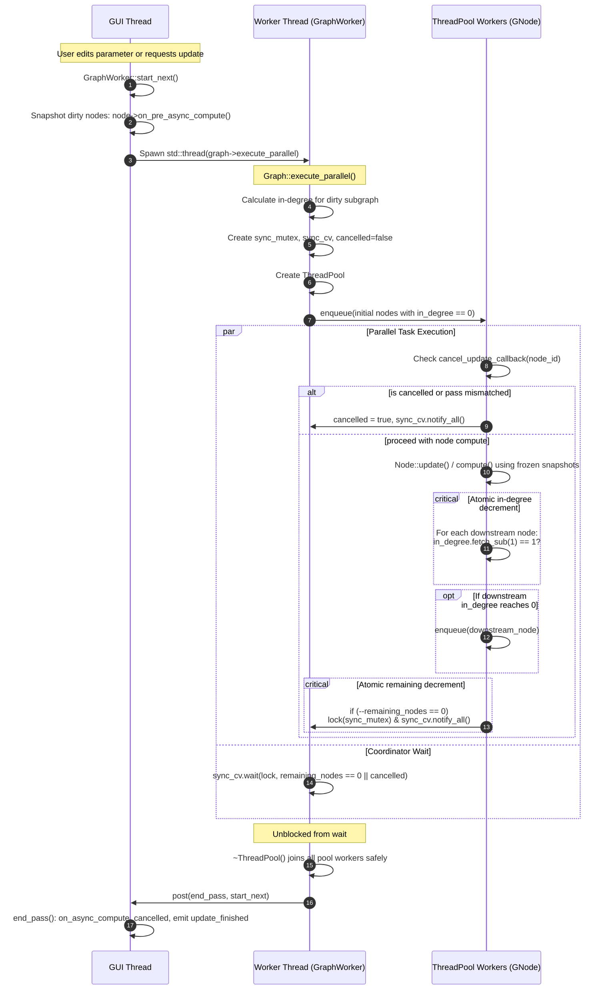
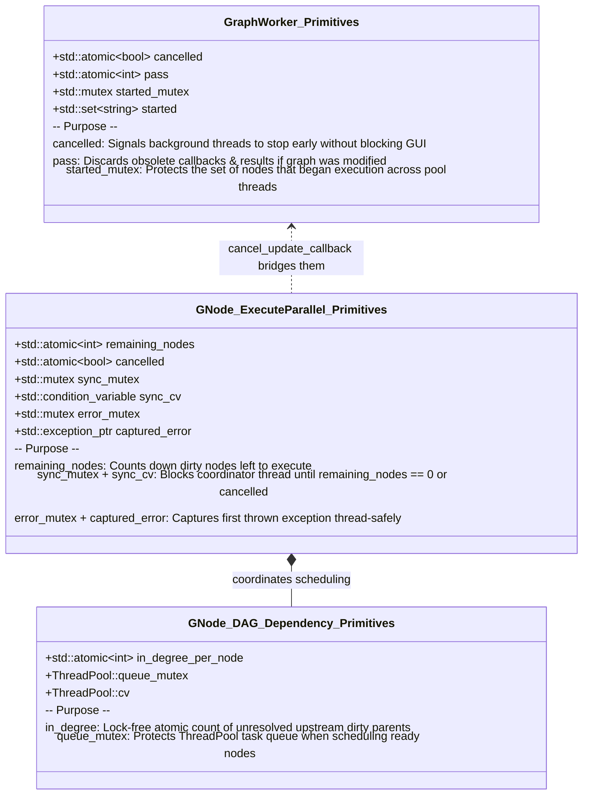
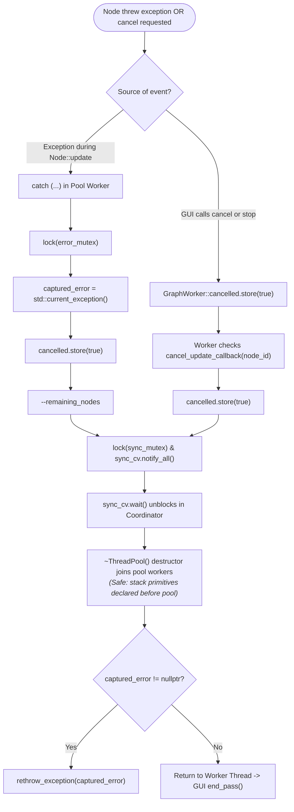

# Asynchronous Graph Update Architecture

This document describes the multi-tier threading model, dependency-driven DAG scheduling, and synchronization mechanisms used during asynchronous graph updates in Hesiod and GNode.

## Overview

The graph update architecture separates user interactions and state changes on the application/GUI thread from heavy computational node processing in the background. Following the principle of **separation of concerns**, update scheduling, coalescing, and lifecycle orchestration are implemented directly in `external/GNode` via `gnode::GraphWorker`:
- **GNode ("Here is a graph, update it")**: `gnode::GraphWorker` manages update requests, queue coalescing, cancellation, pass synchronization, and invokes node execution.
- **Application Hooks ("Follow what's going on")**: Applications (like Hesiod) configure `GraphWorker` static hooks (`post_to_caller`, `thread_setup`, `enabled`) and node lifecycle hooks (`on_pre_async_compute()`, `on_async_compute_cancelled()`) to freeze UI-bound parameters into immutable compute snapshots, dispatch completion callbacks to their event loop (Qt), or initialize thread-local runtime state (OpenMP).

Execution spans three distinct tiers:

1. **Application / GUI Thread (Qt Event Loop)**: Edits node parameters and triggers requests. Freezes node states via the `on_pre_async_compute()` lifecycle hook before background execution begins, and processes `post_to_caller` callbacks asynchronously without blocking the UI.
2. **Pass Coordinator Thread (`gnode::GraphWorker`)**: A dedicated background thread managed by `gnode::GraphWorker` that orchestrates an individual update pass and calls `gnode::Graph::execute_parallel()`.
3. **Task Worker Pool (`gnode::ThreadPool`)**: A pool of worker threads executing independent DAG nodes concurrently as their upstream dependencies complete.

## Architecture & Thread Tiers

The following diagram illustrates how the tiers communicate:





Source: [thread_architecture.mmd](diagrams/thread_architecture.mmd)

## Sequence and Synchronization Flow

The end-to-end execution of a pass proceeds as follows:

1. When an update is triggered, `gnode::GraphWorker::start_next()` invokes `Node::on_pre_async_compute()` on all dirty nodes upfront on the calling thread (e.g. Hesiod's `BaseNode` creates thread-safe parameter snapshots).
2. A coordinator thread is spawned to execute `gnode::Graph::execute_parallel()`.
3. In-degree counts are computed for all dirty nodes in the scheduled subgraph. Nodes with in-degree 0 are dispatched immediately to the `ThreadPool`.
4. As each node finishes, it atomically decrements the in-degree of its downstream neighbors. When a neighbor's in-degree reaches 0, it is enqueued to the pool.
5. The coordinator waits on a `std::condition_variable` until all dirty nodes finish or cancellation is signaled.
6. When the pass completes or is cancelled, `GraphWorker::end_pass()` calls `Node::on_async_compute_cancelled()` on any unfinished nodes and dispatches `Graph::update_finished` back to the caller via `post_to_caller`.





Source: [sequence_flow.mmd](diagrams/sequence_flow.mmd)

## Locking and Synchronization Primitives

Thread safety and inter-thread coordination are achieved using dedicated primitives:





Source: [synchronization_primitives.mmd](diagrams/synchronization_primitives.mmd)

## Cancellation and Exception Safety

To avoid deadlocks and use-after-scope errors during early cancellation or node exceptions:

1. **Stack Lifetime Ordering**: In `gnode::Graph::execute_parallel()`, synchronization primitives (`sync_mutex`, `sync_cv`, `cancelled`, `remaining_nodes`, and captured error state) are declared before `ThreadPool pool`. When exiting scope, `~ThreadPool()` joins all pool threads before any synchronization state is unwound.
2. **Exception Handling**: Node execution is wrapped in a `try ... catch (...)` block. If an exception occurs, the first thrown exception is stored in `captured_error`, `cancelled` is set to `true`, `remaining_nodes` is decremented, and `sync_cv` is notified to wake the coordinator immediately without hanging.
3. **Early Cancellation**: Cancellation callbacks verify whether the pass is still valid or has been cancelled by the GUI before starting a node's computation.





Source: [cancellation_and_exceptions.mmd](diagrams/cancellation_and_exceptions.mmd)

## Multi-Graph Updates and Synchronous Convergence

In complex Hesiod projects, graphs can depend on one another through cross-graph broadcast nodes (`BroadcastNode` and `ReceiveNode` pairs managed by `hesiod::GraphManager`).

### Asynchronous Propagation

During normal asynchronous execution:
1. When a `BroadcastNode` completes on a pool worker thread, `GraphManager::on_broadcast_node_updated()` detects that it is executing in a worker thread (`GraphWorker::in_worker_thread()`).
2. It marshals the notification back to the GUI thread via `worker->post(...)`.
3. The GUI event loop processes the posted notification, determines downstream graphs, and calls `GraphWorker::request()` on receiver graphs. Receiver graphs are queued and scheduled sequentially or concurrently according to layer hierarchy rules.

### Synchronous Flush Convergence in `finish()`

When an operation requires synchronous outputs (e.g. `GraphManager::export_flatten()` or synchronous CLI pipelines):
1. The caller thread invokes `GraphWorker::finish()`, setting `is_finishing = true`.
2. As worker pool threads execute `BroadcastNode`s during `finish()`, calls to `GraphWorker::post()` bypass the Qt event loop (which is blocked by the caller thread) and enqueue directly into an internal thread-safe `flush_callbacks` queue.
3. Between compute steps, `finish()` drains and executes `flush_callbacks` directly on the caller thread.
4. Calling `on_broadcast_node_updated()` immediately calls `request()` on dependent receiver graphs, pushing new jobs onto `this->jobs`.
5. The `finish()` loop continues until both `this->jobs` and `flush_callbacks` are completely drained, ensuring all cascading inter-graph computations complete before `finish()` returns.

```mermaid
sequenceDiagram
    autonumber
    participant GUI as Caller / GUI Thread (Qt Event Loop)
    participant GW as GraphWorker
    participant Pool as ThreadPool (Worker Threads)
    participant GM as GraphManager

    Note over GUI,Pool: --- Asynchronous Inter-Graph Broadcast Flow ---

    GUI->>GW: request(Graph_A, dirty_nodes)
    GW->>Pool: execute_parallel(Graph_A)
    Pool->>Pool: Execute BroadcastNode (tag) in Graph_A

    Note over Pool: in_worker_thread() is true
    Pool->>GM: on_broadcast_node_updated(Graph_A, tag)
    GM->>GW: post([this, tag]() { on_broadcast_node_updated(); })
    GW->>GUI: post_to_caller(Qt event loop)

    Note over GUI: Qt event loop processes posted task asynchronously
    GUI->>GM: execute posted on_broadcast_node_updated(tag)
    loop For each dependent receiver graph (Graph_B)
        GM->>GW: request(Graph_B, dirty_nodes)
    end
    GW->>Pool: schedule start_next() for Graph_B

    Note over GUI,Pool: --- Synchronous Flush Convergence during finish() ---

    Note over GUI: Caller blocks in GraphWorker::finish() (e.g. export_flatten)
    GUI->>GW: finish() [sets is_finishing = true]

    loop While jobs or flush_callbacks remain
        opt If pending jobs in queue
            GW->>Pool: execute_parallel(Graph_A)
            Pool->>GM: on_broadcast_node_updated(tag)
            GM->>GW: post(callback)
            Note over GW: is_finishing is true: callback enqueued to flush_callbacks
        end

        Note over GUI: Caller drains flush_callbacks synchronously
        GW->>GM: callback() runs directly on Caller thread
        GM->>GW: request(Graph_B) adds Graph_B to jobs queue
        Note over GW: jobs queue now has Graph_B; loop continues
        GW->>Pool: execute_parallel(Graph_B)
    end

    Note over GUI: is_finishing = false; all graphs fully updated
```

Source: [multigraph_broadcast_flow.mmd](diagrams/multigraph_broadcast_flow.mmd)

