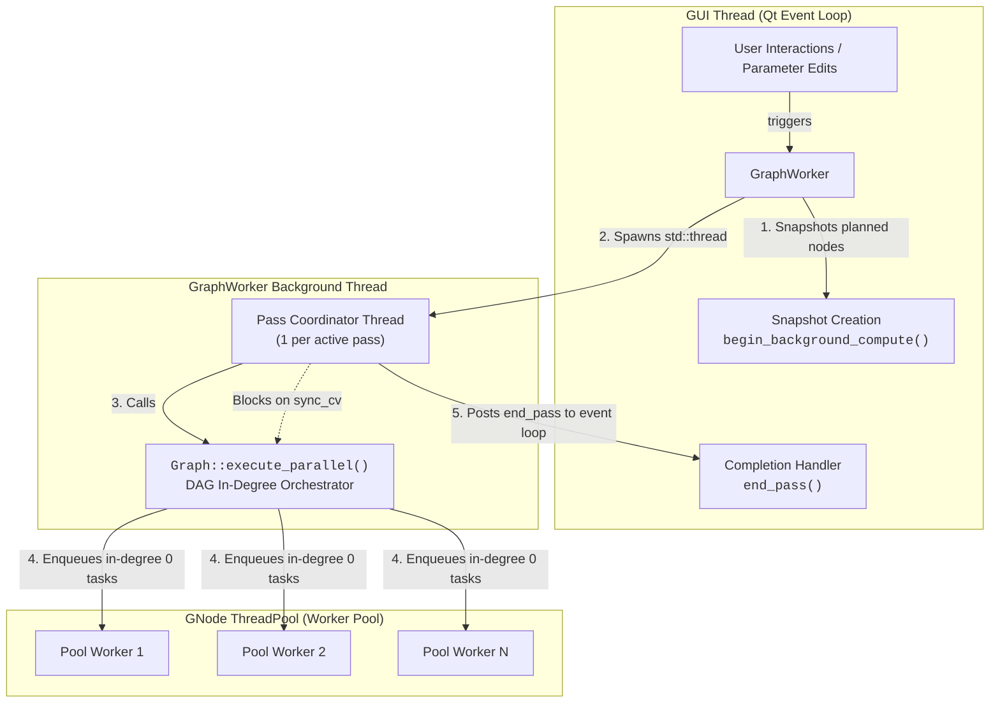
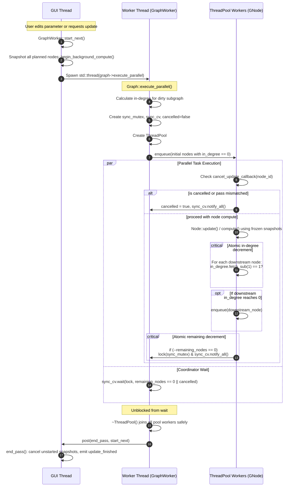
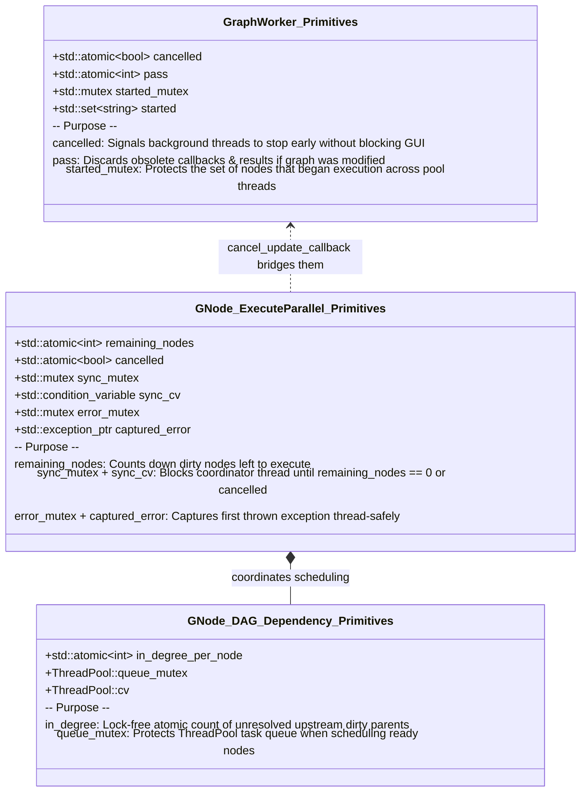

# Asynchronous Graph Update Architecture

This document describes the multi-tier threading model, dependency-driven DAG scheduling, and synchronization mechanisms used during asynchronous graph updates in Hesiod and GNode.

## Overview

The graph update architecture separates user interactions on the GUI thread from heavy computational node processing in the background. It distributes execution across three distinct tiers:

1. **GUI Thread (Qt Event Loop)**: Coordinates graph updates, freezes node states (`begin_background_compute()`) before starting asynchronous passes, and handles completion callbacks without blocking the UI.
2. **Pass Coordinator Thread**: A dedicated background thread managed by `hesiod::GraphWorker` that orchestrates a single update pass.
3. **Task Worker Pool (`gnode::ThreadPool`)**: A pool of worker threads executing independent DAG nodes concurrently as their upstream dependencies complete.

## Architecture & Thread Tiers

The following diagram illustrates how the tiers communicate:

Source: [thread_architecture.mmd](diagrams/thread_architecture.mmd)

## Sequence and Synchronization Flow

The end-to-end execution of a pass proceeds as follows:

1. When an update is triggered, `GraphWorker::start_next()` snapshots all dirty nodes upfront on the GUI thread by invoking `BaseNode::begin_background_compute()`.
2. A coordinator thread is spawned to execute `gnode::Graph::execute_parallel()`.
3. In-degree counts are computed for all dirty nodes in the scheduled subgraph. Nodes with in-degree 0 are dispatched immediately to the `ThreadPool`.
4. As each node finishes, it atomically decrements the in-degree of its downstream neighbors. When a neighbor's in-degree reaches 0, it is enqueued to the pool.
5. The coordinator waits on a `std::condition_variable` until all dirty nodes finish or cancellation is signaled.

Source: [sequence_flow.mmd](diagrams/sequence_flow.mmd)

## Locking and Synchronization Primitives

Thread safety and inter-thread coordination are achieved using dedicated primitives:

Source: [synchronization_primitives.mmd](diagrams/synchronization_primitives.mmd)

## Cancellation and Exception Safety

To avoid deadlocks and use-after-scope errors during early cancellation or node exceptions:

1. **Stack Lifetime Ordering**: In `gnode::Graph::execute_parallel()`, synchronization primitives (`sync_mutex`, `sync_cv`, `cancelled`, `remaining_nodes`, and captured error state) are declared before `ThreadPool pool`. When exiting scope, `~ThreadPool()` joins all pool threads before any synchronization state is unwound.
2. **Exception Handling**: Node execution is wrapped in a `try ... catch (...)` block. If an exception occurs, the first thrown exception is stored in `captured_error`, `cancelled` is set to `true`, `remaining_nodes` is decremented, and `sync_cv` is notified to wake the coordinator immediately without hanging.
3. **Early Cancellation**: Cancellation callbacks verify whether the pass is still valid or has been cancelled by the GUI before starting a node's computation.

Source: [cancellation_and_exceptions.mmd](diagrams/cancellation_and_exceptions.mmd)
