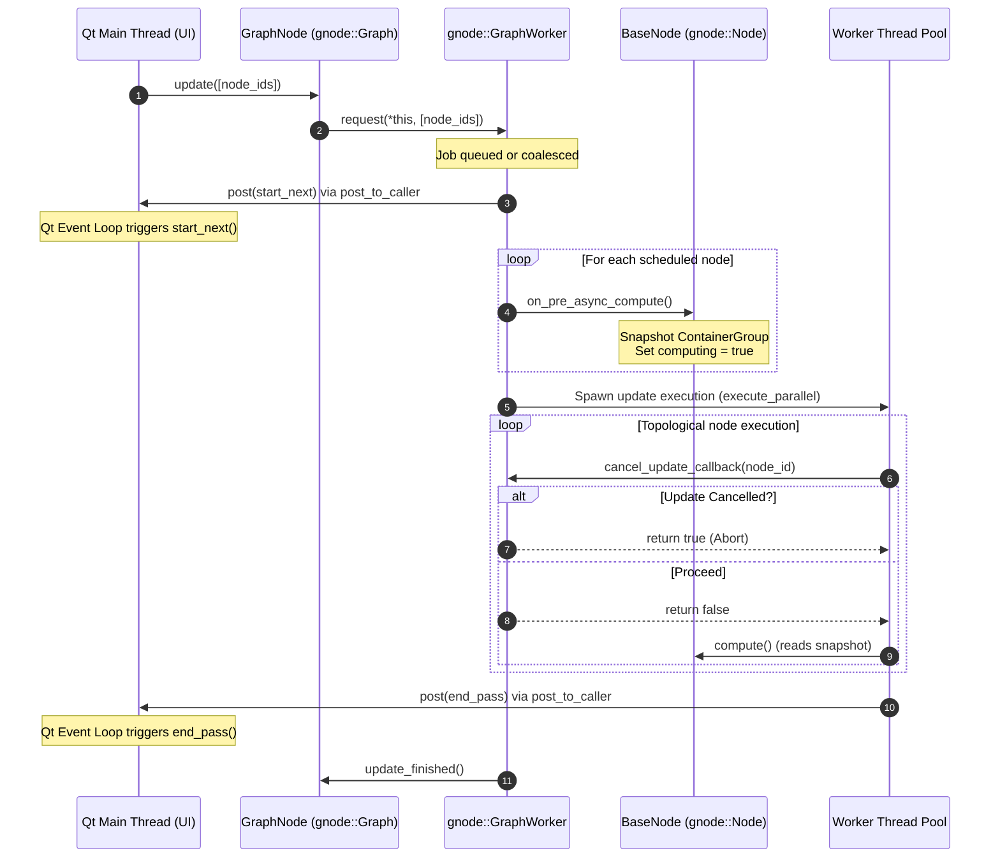
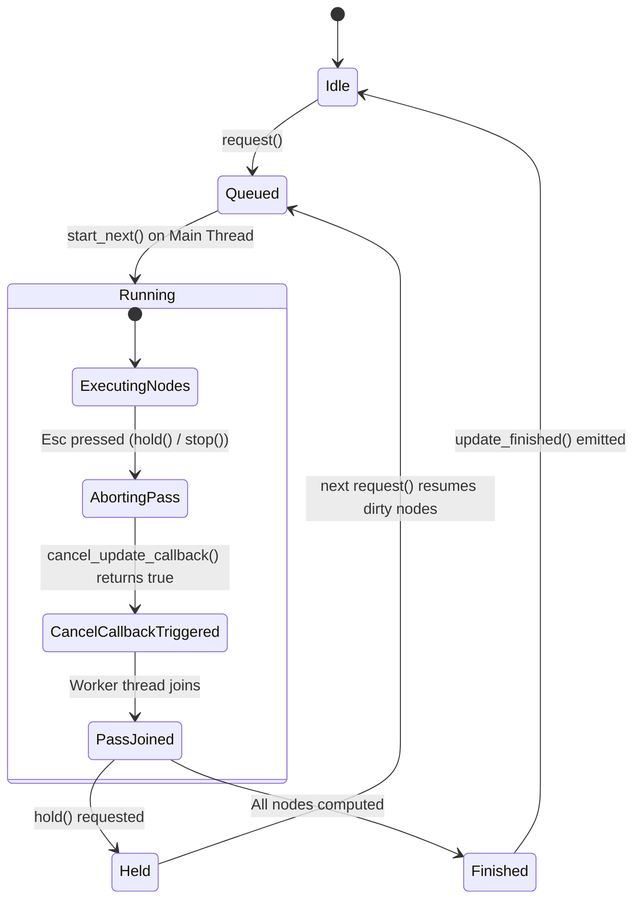
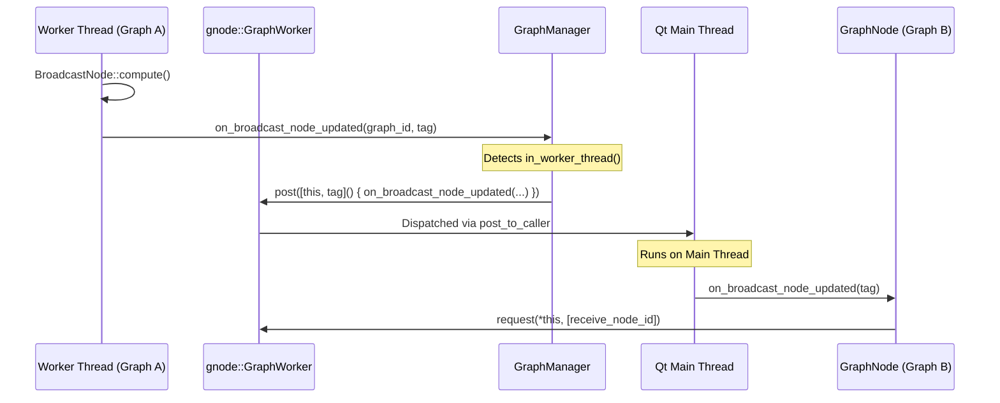

# Graph Update Architecture

Hesiod delegates graph topology traversal, parallel execution scheduling, and asynchronous worker thread orchestration to GNode (`gnode::GraphWorker` and `gnode::Graph`).

This document details the update lifecycle, thread boundaries, state snapshotting, cancellation handling, and inter-graph broadcast synchronization.

## Architecture Overview

Hesiod maintains a separation of concerns:
- `GraphManager`: Owns a single `gnode::GraphWorker` instance per project and coordinates multi-graph dependencies (inter-graph `Broadcast` and `Receive` data distribution).
- `GraphNode`: Inherits from `gnode::Graph` and `hmap::CoordFrame`. Represents an individual terrain layer or graph, dispatching update requests to the shared worker.
- `BaseNode`: Inherits from `gnode::Node`. Implements the async compute lifecycle hooks (`on_pre_async_compute` and `on_async_compute_cancelled`) to snapshot settings and isolate live UI modifications from background execution.
- `gnode::GraphWorker`: Background worker queue and executor provided by the GNode library. Manages thread pools, job coalescing, topological dependency sorting, and cooperative thread-safe cancellation.

## Thread Boundaries and Lifecycles

In interactive GUI mode, the application runs on the main Qt thread. Computation of complex terrain operations (OpenCL kernels, SIMD erosion models, OpenMP parallel algorithms) runs on worker threads managed by `gnode::GraphWorker`.

### Static Worker Callbacks Setup

At application startup or project initialization (`AppContext::new_project`):

```cpp
gnode::GraphWorker::enabled = [this]()
{
  return !this->headless && this->app_settings.node_editor.async_update;
};

gnode::GraphWorker::post_to_caller = [](std::function<void()> fct)
{
  QMetaObject::invokeMethod(qApp, std::move(fct), Qt::QueuedConnection);
};

gnode::GraphWorker::thread_setup = [this]()
{
  hmap::init_openmp(this->app_settings.global.omp_num_threads);
};
```

- `enabled`: Determines if background updates are active. If disabled (e.g. CLI batch modes or setting toggled off), requests fall back to synchronous execution.
- `post_to_caller`: Dispatches callbacks back onto the caller thread's event loop (Qt `invokeMethod` queued connection).
- `thread_setup`: Runs on worker threads before node computation (e.g. setting OpenMP thread pool limits).

## Update Flow Process

When a node or graph is updated (e.g. from UI parameter edit, connection change, or manual reload):



## Settings Snapshotting & Isolation

To allow responsive interaction in the UI while a calculation runs in the background, `BaseNode` freezes its settings when `on_pre_async_compute()` is invoked:

1. `BaseNode::on_pre_async_compute()` creates a serialized copy of the current `meta::ContainerGroup` into `frozen_meta_group` and sets `computing = true`.
2. When the worker thread runs `BaseNode::compute()`, `BaseNode::get_meta_group()` detects that execution is inside the worker thread (`gnode::GraphWorker::in_worker_thread()`) and serves settings exclusively from `frozen_meta_group`.
3. The user can adjust parameters in the Qt property inspector without data races, modifying only the live container group.
4. If a port value is inspected from another node or UI preview while `computing == true`, `BaseNode::is_port_busy()` prevents unsafe simultaneous read/write access.
5. If an update pass is cancelled before an already-snapshotted node can be executed, `on_async_compute_cancelled()` clears the computing state.

## Cancellation and Hold State

Users can interrupt or pause background computation (e.g. pressing `Escape` or activating the stop tool):



- `hold()`: Cooperatively signals cancellation to the active pass. The incomplete set of dirty nodes is preserved in a resumed job queue. The editor displays the held state until the next user action resumes execution.
- `stop()`: Cancels current pass and blocks until worker threads exit, ensuring safe structural modifications.
- `cancel()`: Discards all pending and queued jobs for a graph.
- `finish()`: Flushes and computes all queued jobs synchronously, draining posted callbacks immediately (used before project exports and bakes).

## Inter-Graph Broadcasting Flow

When a graph contains a `Broadcast` node, downstream graphs connected via `Receive` nodes update responsively:



Because `on_broadcast_node_updated` checks `gnode::GraphWorker::in_worker_thread()`, signals generated asynchronously on worker threads are posted cleanly to the Qt event loop before notifying dependent graphs.
