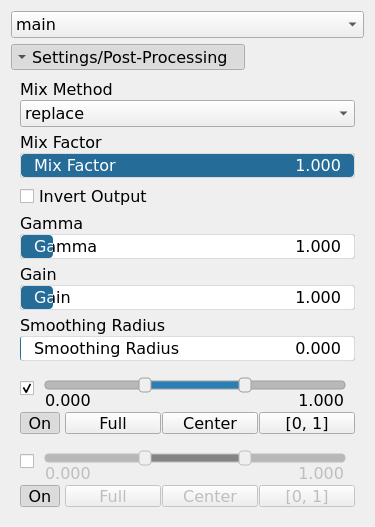
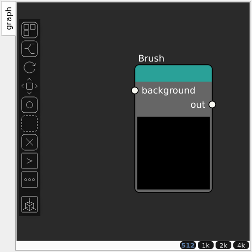

Brush Node
==========

A manual brush tool for directly painting heightmaps, allowing interactive terrain editing.

## Category

Primitive/Authoring
## Inputs

|Name|Type|Description|
| :--- | :--- | :--- |
|background|VirtualArray|No description|

## Outputs

|Name|Type|Description|
| :--- | :--- | :--- |
|output|VirtualArray|The generated heightmap from brush strokes.|

## Parameters

|Name|Type|Description|
| :--- | :--- | :--- |
|HeightMap|Array|The heightmap data representing the painted terrain.|
|Gain|Float|Mid-centered gain transformation applied to the elevation values. This is a non-linear recurve operator centered around the mid elevation (typically 0.5). Increasing the gain pushes values toward the minimum and maximum elevations, creating flatter low/high regions with a steeper transition around the midpoint.|
|Gamma|Float|Standard gamma correction applied to the elevation values. This is a monotonic power-law remapping that shifts emphasis toward low or high elevations, making the overall shape sharper or bulkier without changing its ordering.|
|Invert Output|Bool|Inverts the output values after processing, flipping low and high values across the midrange.|
|Mix Factor|Float|Mixing factor for blending input and output values. A value of 0 uses only the input, 1 uses only the output, and intermediate values perform a linear interpolation.|
|Mix Method|Enumeration|Method used to combine input and output values. Options include linear interpolation (default), min, max, smooth min, smooth max, add, and subtract.|
|Remap Range|Value range|Linearly remaps the output values to a specified target range (default is [0, 1]).|
|Saturation Range|Value range|Modifies the amplitude of elevations by first clamping them to a given interval and then scaling them so that the restricted interval matches the original input range. This enhances contrast in elevation variations while maintaining overall structure.|
|Smoothing Radius|Float|Defines the radius for post-processing smoothing, determining the size of the neighborhood used to average local values and reduce high-frequency detail. A radius of 0 disables smoothing.|

## Example

Corresponding Hesiod file: [Brush.hsd](../../examples/Brush.hsd). Use [Ctrl+I] in the node editor to import a hsd file within your current project.

!!! note
    Example files are kept up-to-date with the latest version of [Hesiod](https://github.com/otto-link/Hesiod).
    If you find an error, please [open an issue](https://github.com/otto-link/Hesiod/issues).

## Painting resolution

New brushes store a 512 × 512 painting by default, independently of the graph
resolution. This uses 1 MiB of float data even in a 4096 × 4096 graph. The paint
canvas uses a separate 256 × 256 field; the node resamples the stored painting
to the graph resolution when computing its output.

Choose **New brush storage resolution** in **Settings → Node Editor** to change
the default for new Brush nodes (128–4096 pixels per side). Higher values use
more memory and produce larger project files. Existing paintings retain their
saved dimensions and values when loaded, duplicated, or saved again.
