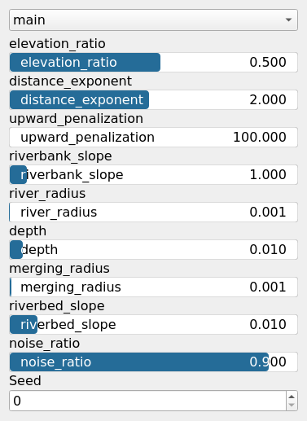

FlowStream Node
===============

TODO

## Category

WIP
## Inputs

|Name|Type|Description|
| :--- | :--- | :--- |
|input|VirtualArray|Input heightmap terrain.|
|sources|Cloud|Cloud of source coordinates from which flow streams originate.|
|noise_r|VirtualArray|Optional noise array to perturb trench width.|

## Outputs

|Name|Type|Description|
| :--- | :--- | :--- |
|output|VirtualArray|Output heightmap with carved river channels.|
|water_depth|VirtualArray|Water depth computed as the difference between input and output terrain.|

## Parameters

|Name|Type|Description|
| :--- | :--- | :--- |
|control_points_count|Integer|Number of control points sampled for the triangulation mesh.|
|depth|Float|Maximum depth of the carved riverbed.|
|distance_exponent|Float|Exponent applied to distance/elevation terms when evaluating path costs.|
|elevation_ratio|Float|Weight given to elevation difference versus distance in the cost function.|
|enable_width_depth_scaling|Bool|Modulates trench width based on local elevation difference.|
|favor_domain_center|Bool|Biases flow paths toward passing through the center of the domain.|
|favor_stream_merging|Bool|Biases stream pathfinding toward merging with existing streams.|
|radial_profile|Enum|Profile shape used across the trench cross-section.|
|radial_profile_parameter|Float|Sharpness or shape exponent for the radial profile.|
|Seed|Random seed number|Random seed number. The random seed is an offset to the randomized process. A different seed will produce a new result.|
|truncate_merging_paths|Bool|Truncates streams at the point where they intersect previously traced streams.|
|upward_penalization|Float|Penalty factor applied to uphill elevation changes during pathfinding.|
|valley_factor|Float|Attenuation factor per distance unit in valley attraction towards existing streams.|
|valley_radius|Float|Radius around existing streams to apply pathfinding attraction.|
|width|Float|Width of the carved river trench.|
|width_exponent|Float|Scaling exponent for width with distance to outlet.|

## Example

!!! note "No example yet"
    No example available for this node.
