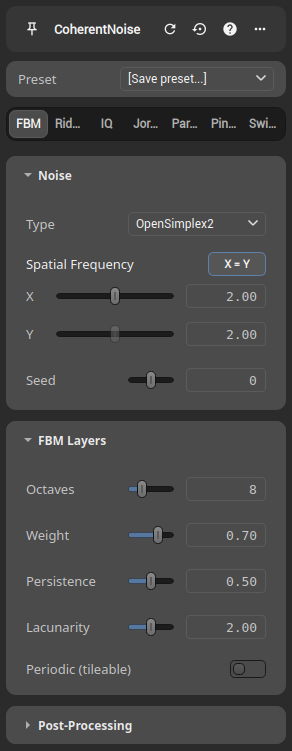

# The Node Settings Toolbar

Every node's settings panel features a toolbar across the top header. Primary actions are directly accessible as icon buttons, while secondary actions are organized under the overflow menu (**More Actions** `···`).

## Overview

### Primary Actions

| Button (tooltip)        | What it does                                          |
|-------------------------|------------------------------------------------------|
| **Force Update**        | Re-runs this node's computation.                     |
| **Reset Settings**      | Restores the node's initial (default) settings.      |
| **Help!**               | Opens the node's in-app documentation popup.         |

### Overflow Menu Actions (`···`)

| Action                  | What it does                                          |
|-------------------------|------------------------------------------------------|
| **Node Information**    | Opens the detailed node information dialog.          |
| **Backup State**        | Snapshots the current settings into the backup slot. |
| **Revert State**        | Swaps the current settings with the backup slot.     |
| **Online Documentation**| Opens the node's page in the online documentation.   |

## Force Update

**Force Update** re-runs the node's computation on demand. Nodes normally recompute
automatically when an input or a parameter changes, so you rarely need this — it is handy
when you want to force a fresh evaluation (for example after changing a setting that feeds
randomness) without otherwise touching the graph.

## Backup and Revert State (swap mechanism)

The **Backup State** and **Revert State** actions provide a **manual two-slot swap mechanism** for temporary state management during editing. The backup slot lives in memory and is not saved with your project.

### How it works

1. **Backup State**: Saves the current configuration into the backup slot.
2. **Revert State**: Swaps the current configuration with the one stored in the backup slot.

This lets you toggle between two configurations, which is useful for quickly testing variations.

### Example

1. Start with a node in **Config1**.
2. Click **Backup State** → Config1 is stored.
3. Modify the node → it becomes **Config2**.
4. Click **Revert State** → the node reverts to Config1, and Config2 is now stored.
5. Click **Revert State** again → the node reverts to Config2, and Config1 is now stored again.
6. This "swap" can continue back and forth.

### Continuing with new changes

- If you're happy with Config2, click **Backup State** to overwrite the backup slot with Config2.
- Modify the node to reach **Config3**.
- Now, clicking **Revert State** will swap between Config2 and Config3.

## Reset Settings

**Reset Settings** restores the node to its initial (default) settings. This is different
from **Revert State**: Revert swaps with the snapshot *you* took, whereas Reset discards
your changes entirely and returns the node to its defaults.

## Node Presets

To permanently save, load, or manage presets for a node, use the **Preset Dropdown** located right above the parameters in the node settings panel. See the dedicated [Node Presets](presets.md) page for details on using presets and configuring global preset collections.

## Help and Online Documentation

The documentation buttons provide access to node reference material:

- **Help!**: Opens the node's documentation in an **in-app popup**, allowing you to read it without leaving Hesiod.
- **Online Documentation**: Opens the node's page on the **online documentation** in your default web browser.
