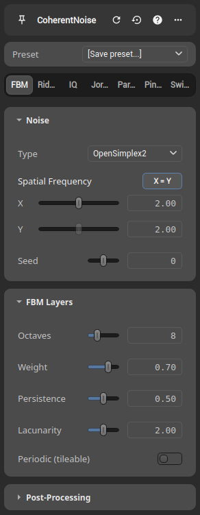
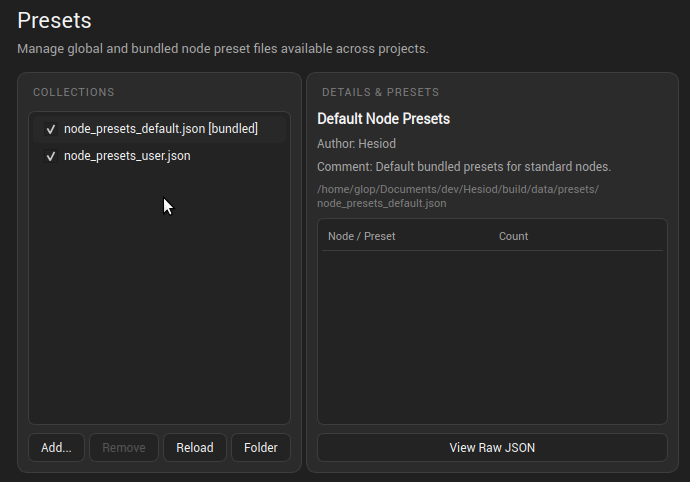

# Node Presets

Node presets allow saving, applying, and sharing configurations for any node in Hesiod. Presets capture the complete parameter state across all categories and tabs of a node, making it straightforward to reuse complex configurations or test variations without manually re-entering values.

## Using Presets in the Node Settings Panel

At the top of each node's properties panel, a preset dropdown selector sits above the parameter sections:



### Applying a Preset
Click the preset dropdown and select an existing preset from the list (such as bundled defaults or custom saved presets). The node immediately updates its parameters, switches to the preset's active category tab if relevant, triggers a graph update, and records the action on the undo/redo stack (`Ctrl+Z` / `Ctrl+Shift+Z`).

### Saving a New Preset
1. Adjust the node parameters to the desired configuration.
2. Open the preset dropdown and choose **Save preset...**.
3. Enter a descriptive name in the dialog and confirm.
4. The preset is saved into your personal user preset file and becomes immediately available in the dropdown whenever editing that node type.

### Deleting a Preset
Right-click a custom preset in the dropdown menu and select **Delete** to remove it. Bundled presets cannot be deleted.

## Preset Storage and JSON Format

Presets are stored as JSON files on disk and loaded globally across projects.

### Discovery Locations
Hesiod scans preset files matching the naming pattern `node_presets_*.json` in the following locations:

- **Bundled presets**: Located in the application distribution directory under `data/presets/node_presets_default.json`. These provide curated default starting points for standard nodes.
- **User presets**: Stored in the user configuration directory under `presets/node_presets_user.json` (for example, `~/.config/hesiod/presets/node_presets_user.json` on Linux). New presets saved via the UI are written here.
- **Custom / Imported collections**: Additional `node_presets_*.json` files placed in the user presets folder or imported through the application settings.

### File Structure
Preset files use a simple human-readable JSON schema:

```json
{
  "format_version": 1,
  "title": "Community Terrain Presets",
  "author": "Hesiod User",
  "comment": "Curated presets for erosion and terrain noise generators.",
  "presets": {
    "CoherentNoise": {
      "Alpine Ridges": {
        "containers": {
          "FBM": {
            "octaves": { "value": 8 },
            "lacunarity": { "value": 2.0 },
            "persistence": { "value": 0.5 }
          }
        },
        "current": "FBM"
      }
    }
  }
}
```

Because presets are stored in standard JSON files, they can easily be committed to version control, archived, or shared between team members.

## Managing Presets in App Settings

Hesiod provides a dedicated preset manager in the **App Settings** dialog under the **Presets** tab (`Edit` > `App Settings` > `Presets`):



### Collections Overview
The left pane lists all detected preset collections:
- **Enable / Disable**: Toggle the checkbox next to any collection to activate or deactivate its presets across Hesiod.
- **Add...**: Import an external `node_presets_*.json` file into your user presets folder.
- **Remove**: Delete a selected user preset collection file from disk (bundled files cannot be removed).
- **Reload**: Rescan disk directories and refresh all preset definitions.
- **Folder**: Open the user preset folder directly in your system file manager to manually add, backup, or share preset files.

### Details and Inspection
The right pane provides information on the currently selected collection:
- Metadata including file title, author, description, and absolute file path on disk.
- An interactive tree showing all supported node types and preset names contained within the file.
- A **Show Raw JSON** toggle to inspect or verify the underlying JSON payload directly in Hesiod.
